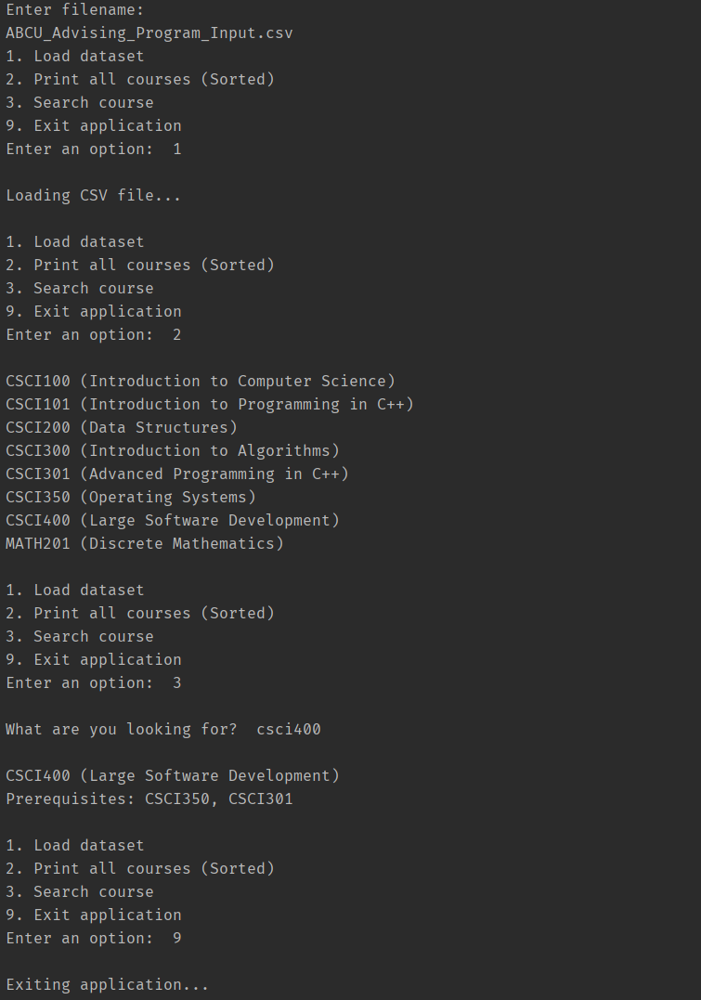

# ABCU Course Planner

A digital course planner developed for ABCU, built to manage, query, and sort academic course data efficiently.

## Prerequisites

Ensure the following tools are installed and available in your system PATH:

- <a href="https://cmake.org/download/" target="_blank">CMake</a> (3.25+): Build system generator.

- <a href="https://git-scm.com/install/windows" target="_blank">Git</a>: Required for FetchContent dependency
  management.

- <a href="https://releases.llvm.org/download.html" target="_blank">Clang-Format</a> : Required for automated code style
  enforcement.

## Getting Started

### Configuration

Initialize the build system and download dependencies.
Bash

`cmake -B build`

### Compilation

Compile the entire project, including tests and benchmarks.
Bash

`cmake --build build`

## Project Reflection
### The Problem
The objective of this project was to engineer a robust course planner capable of dynamically parsing a CSV file, searching for specific courses and their prerequisites, and displaying the entire academic catalog in alphanumeric order.
Because the application required both rapid querying and inherently sorted data output, standard linear data structures were insufficient.
The program needed to interact with users at runtime, handle malformed input gracefully, and strictly manage heap memory without leaking.

### The Approach
I approached this problem from a software architecture perspective rather than jumping straight into implementation.
I first developed the high-level algorithms using structural pseudocode, contrasting the theoretical limits of standard Vectors, Hash Tables, and Trees.
By calculating the asymptotic upper bounds (Big-O) for each structure, I deduced that a custom Binary Search Tree (BST) was the optimal choice.
It provided an excellent O(logn) search time while allowing the catalog to be printed in perfectly sorted order in O(n) time via an In-Order traversal.
Furthermore, I optimized the file-parsing pipeline by integrating a temporary Hash Set cache to filter out invalid prerequisites in O(1) time, demonstrating a practical hybrid-structure approach.

### Overcoming Roadblocks
While the comprehensive planning phase made the general implementation of this specific project straightforward, managing recursive memory operations during the broader coursework presented a distinct challenge.
For instance, one of the most significant technical roadblocks I encountered was implementing the two-child node deletion within a Binary Search Tree.
Rather than simply shifting an array index, I had to securely locate the In-Order Successor, cleanly hijack the payload data, and recursively unwind the call stack to re-link the underlying pointers without causing segmentation faults or memory leaks.
Researching standard algorithm behaviors and rigorously mapping the call stack allowed me to engineer a stable, fully recursive solution that ultimately informed my architectural decisions moving forward.

### Expansion & Evolution
Historically, I have sometimes relied on a "code-first, optimize-later" mentality.
This project fundamentally evolved my approach to software design, cementing the value of upfront architectural planning.
Writing structured pseudocode and performing mathematical algorithm evaluations prior to compilation ensured I deployed the correct tool for the job, rather than just forcing a brute-force solution to work.

Looking forward, this project highlighted the critical need for automated testing.
While the current program was manually tested across different compilers and edge cases, integrating a formal Test-Driven Development (TDD) framework would make the application vastly more resilient to regressions.
Additionally, while the current architecture successfully captures file names via runtime user input to ensure data freshness, future iterations would benefit from supporting strict command-line argument passing to facilitate better integration with automated CI/CD pipelines.